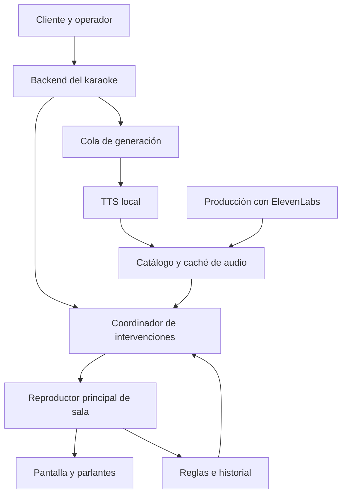
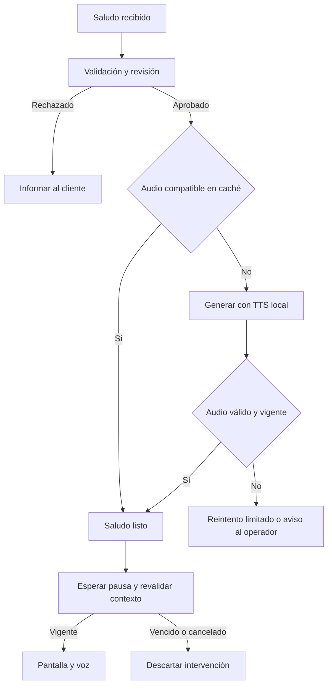

# Diseño del animador y los saludos del karaoke

**Proyecto:** software de karaoke para una pizzería, con Il Gatto como primer escenario de uso.\
**Versión:** 1.0 — 25 de octubre de 2026.\
**Estado:** diseño funcional y técnico propuesto para implementación.

El sistema incorporará un animador automático con frases expresivas reutilizables, saludos escritos por los clientes y convertidos a voz con un modelo local, mensajes coordinados en pantalla y efectos sonoros. La prioridad es acompañar la experiencia con intervenciones oportunas y variadas, conservando el protagonismo de quienes cantan y conversan.

## 1 Decisiones y alcance

| Aspecto | Decisión |
| --- | --- |
| Voz principal del animador | ElevenLabs Eleven v4 para producir el catálogo de audios y ampliarlo de forma controlada. |
| Saludos y dedicatorias personalizados | Generación con TTS local; sin llamadas a ElevenLabs por cada saludo. |
| Motor local concreto | Intercambiable. Kokoro es candidato inicial para CPU; Chatterbox LATAM es candidato para evaluar expresividad. Se elige mediante una prueba auditiva en el equipo de destino. |
| Reproducción cotidiana | Archivos locales o descargados previamente; la reproducción no depende de una llamada de generación. |
| Pantalla | Muestra el mensaje aprobado y el contexto de la dedicatoria de forma coordinada con el audio. |
| Variación | Selección por eventos, familias de contenido e historial persistente entre sesiones y días. |
| Operación | Automática dentro de reglas; el operador puede aprobar, pausar, omitir y cancelar. |
| Personalidad | Cercana, alegre y adecuada al público peruano, con intensidad moderada y humor breve. |

Las decisiones anteriores recogen el objetivo acordado. Los valores numéricos, tablas, eventos y endpoints siguientes son propuestas iniciales configurables. La implementación debe adaptarse al backend y al reproductor existentes, conservando sus mecanismos de usuarios, locales, mesas, sesiones y canciones.

El alcance incluye catálogo, caché, nombres, saludos, pantalla, mezcla de audio, sonidos de ambiente para las pausas, programación por eventos y administración. El reconocimiento de conversaciones, la valoración automática del canto y la integración con pedidos de cocina quedan fuera del MVP. Un evento de cocina podrá incorporarse después si proviene realmente del sistema de pedidos o de una acción del personal.

## 2 Experiencia del cliente y del operador

### 2.1 Cliente que solicita música o karaoke

1. Accede desde el QR de la mesa y solicita una canción para escuchar o cantar.
2. Opcionalmente escribe un saludo: destinatario, remitente y mensaje breve. La mesa se obtiene de la sesión cuando corresponda.
3. Ve una vista previa del texto que se publicará y acepta su reproducción pública.
4. Envía la solicitud. La interfaz informa si está pendiente de revisión, en preparación o programada; nunca anuncia una hora que todavía no está reservada.
5. En una pausa adecuada aparece el saludo en pantalla y se reproduce su audio.

La solicitud de canción y el saludo son registros relacionados pero independientes. Un saludo rechazado o un fallo de voz no cancela la canción. Si está vinculado a una canción, su reproducción debe respetar esa relación o pedir al operador que la desvincule.

### 2.2 Operador del local

Dispone de una bandeja de saludos con texto, mesa, canción asociada, antigüedad y estado. Puede escuchar una previsualización en una salida de monitoreo, aprobar, corregir pronunciación, rechazar o cancelar. La previsualización no debe salir por los parlantes del público ni contarse como reproducción pública.

La corrección de pronunciación mantiene el significado y la escritura mostrada. Una edición que cambia el contenido o lo resume requiere una nueva aceptación del cliente o una solicitud nueva con el contenido acordado.

El panel también permite elegir modo Cena, Mixto o Fiesta; silenciar al animador; suspender saludos; activar una celebración confirmada; y detener inmediatamente una intervención. La música y la cola de karaoke siguen funcionando aunque el módulo de animación esté deshabilitado.

## 3 Personalidad y límites de actuación

El animador habla como anfitrión del local: frases cortas, dicción clara, energía cálida y pequeñas variaciones de ritmo. Puede usar expresiones como «¡Vamos con ese aplauso!» o «Entre canción y canción, seguimos compartiendo». El tono peruano se validará con oyentes del negocio; no basta con seleccionar el idioma español.

| Situación | Comportamiento |
| --- | --- |
| Persona que termina de cantar | Agradecer su participación; los aplausos son un efecto de acompañamiento. |
| Cumpleaños | Activarlo después de una confirmación del cliente o del personal. |
| Persona que demora en salir | Recordatorio amable, con límite de repeticiones y opción de omitir. |
| Comida y promociones | Usar únicamente información vigente y configurada por el local. |
| Guiños humanos | «Probando, uno, dos, tres», una risa breve o una pausa expresiva, en momentos poco frecuentes. |
| Ambiente desconocido | Evitar afirmar que se ve una mesa, se escuchó un comentario o salió una pizza sin un evento real que lo confirme. |

Las bromas no califican negativamente la voz, apariencia o identidad del cliente. El sistema se presenta como animación virtual en su configuración e información del servicio; su naturalidad proviene de la interpretación y del momento de intervención.

## 4 Arquitectura propuesta



| Componente | Responsabilidad |
| --- | --- |
| Backend existente | Autenticación, aislamiento por local, solicitudes, aprobación, persistencia y emisión de eventos. |
| Servicio de TTS local | Modelo residente en memoria, generación de archivos, métricas y estado de salud. |
| Cola de generación | Trabajos asíncronos, deduplicación, límites de concurrencia y reintentos. Puede reutilizar la infraestructura de colas existente. |
| Catálogo y caché | Frases, efectos, unidades con nombres y saludos completos; metadatos de voz, duración y calidad. |
| Coordinador | Decide qué intervención corresponde, cuándo puede comenzar y cuándo debe descartarse. |
| Reproductor de sala | Reserva la pausa, reproduce audio, presenta el mensaje y confirma inicio y final. |
| Historial | Registra lo efectivamente iniciado y terminado, además de fallos e interrupciones. |

El servicio de voz tendrá un adaptador independiente del motor. El backend del karaoke lo consumirá por HTTP o mediante la cola disponible; no se obliga a trasladar el software a Python. Los nombres de rutas de este documento expresan contratos propuestos, no APIs ya existentes.

### 4.1 Ubicación del modelo local

La instalación preferida para un solo negocio es un servicio junto al equipo del karaoke o en otro equipo de la LAN. Un servidor propio central también es posible: elimina el consumo de una API TTS externa, pero los saludos nuevos dependerán de la conexión entre el local y ese servidor.

Los modelos, voces, recursos de pronunciación y dependencias se descargan durante la instalación. La prueba de funcionamiento sin Internet debe hacerse con esos recursos ya disponibles. La caché de reproducción de cada local conserva los archivos necesarios para la sesión.

## 5 Estrategia de voces

### 5.1 Animador principal

Se produce un catálogo con Eleven v4, una voz estable y perfiles moderados: cálido, alegre y celebración. Cada audio se escucha y aprueba antes de incorporarlo al catálogo activo. El modelo, la voz y sus ajustes se guardan como metadatos de versión.

ElevenLabs documenta el identificador `eleven_v4` y su disponibilidad mediante Text to Dialogue. El adaptador debe usar la API compatible con ese modelo y mantener el identificador configurable [1].

### 5.2 Voz local de saludos

Se genera el saludo completo en una sola intervención: nombre, remitente y mensaje. Esto mantiene un contexto de entonación y reduce la necesidad de unir palabras aisladas.

| Motor candidato | Papel en la evaluación |
| --- | --- |
| Kokoro | Primera prueba en CPU. Tiene las voces españolas `ef_dora`, `em_alex` y `em_santa`; no están identificadas como peruanas. Su interfaz estándar no ofrece instrucciones emocionales como las de ElevenLabs [2][3]. |
| Chatterbox LATAM | Prueba de expresividad y acento usando una referencia peruana autorizada. Su variante regional es latinoamericana/México, no una garantía de acento peruano [4]. |
| Qwen3-TTS 1.7B | Alternativa posterior si se requiere mayor control de estilo y el hardware lo permite. Las capacidades cambian entre Base, CustomVoice y VoiceDesign [5]. |

Los perfiles internos serán `calido`, `alegre` y `celebracion_suave`. El adaptador declara cuáles puede ejecutar. En Kokoro, un perfil puede limitarse a voz, velocidad y tratamiento del texto; no se anunciará como emoción controlada. Las etiquetas del animador no se transfieren directamente al texto del cliente.

La documentación de Kokoro advierte sobre resultados más débiles en emisiones muy cortas, especialmente por debajo de 10–20 tokens. La evaluación incluirá saludos completos y nombres difíciles, no solamente palabras sueltas [2].

### 5.3 Coherencia entre ambas voces

El animador puede introducir una sección: «Llegó un saludo para compartir». Tras un separador breve, la segunda voz lee el mensaje completo. Esta identidad de sección permite que el cambio de voz tenga sentido.

No se alternarán motores dentro de una misma oración. Si se desea una identidad de voz equivalente entre motores, habrá que evaluarla con grabaciones propias o autorizadas y verificar sus condiciones de uso; la equivalencia no es un requisito del MVP.

## 6 Catálogo inicial de frases y sonidos

La cantidad siguiente es una meta de producción inicial, no una obligación de generar todo antes del piloto. Cada familia debe tener varias redacciones, no únicamente la misma frase con distinta emoción.

| Familia | Variantes iniciales | Ejemplo | Activación |
| --- | --- | --- | --- |
| Bienvenida | 6 | «Bienvenidos a Il Gatto. Buena pizza y canciones para compartir». | Apertura confirmada de sesión. |
| Invitación a participar | 8 | «Tu próxima canción empieza en el QR de tu mesa». | Pausa elegible, con baja frecuencia. |
| Presentación de turno | 10 | «El siguiente escenario ya tiene protagonista». | Turno confirmado. |
| Cierre de participación | 10 | «¡Gracias por compartir esa canción con nosotros!». | Fin natural de karaoke, no por fallo o salto. |
| Introducción a saludos | 6 | «Tenemos una dedicatoria para esta noche». | Saludo listo. |
| Cumpleaños y celebraciones | 6 | «¡Hoy tenemos un motivo extra para celebrar!». | Evento confirmado. |
| Pizzería y convivencia | 6 | «Una canción más y seguimos compartiendo la mesa». | Modo y horario compatibles. |
| Guiños de cabina | 4 | «Probando, uno, dos, tres… ahora sí». | Pausa tranquila y límite estricto. |
| Despedida | 4 | «Gracias por compartir sus canciones. ¡Hasta la próxima!». | Cierre confirmado. |

**Meta inicial:** 60 clips de voz distribuidos en nueve familias. El piloto puede comenzar con tres variantes por familia y ampliar según uso real.

| Efecto | Variantes iniciales | Uso |
| --- | --- | --- |
| Aplauso corto | 3 | Cierre o celebración, sin reproducirlo después de toda canción. |
| Aplauso de celebración | 2 | Cumpleaños o momento especial confirmado. |
| Separador musical | 3 | Entrada de saludos y transición de voces. |
| Redoble breve | 1 | Celebración puntual, con límite de frecuencia. |
| Campanilla suave | 1 | Aviso visual o entrada de sección. |
| Ambiente de cabina | 2 | Guiños ocasionales, a volumen bajo. |

Las risas del animador conviene integrarlas en clips completos. Se evitan abucheos, alarmas, bocinas estridentes y efectos que parezcan averías. Cada recurso conserva procedencia y permiso de uso comercial; los niveles finales se calibran con el sistema de sonido del local.

## 7 Nombres y frases combinables

La reutilización de nombres se mantiene para los anuncios del animador, pero se hace con unidades pensadas para unirse. No se exige que un único archivo de «Ana» sirva para todas las posiciones y emociones.

Ejemplo de composición admisible:

1. Clip fijo: «El siguiente turno ya está listo».
2. Unidad con nombre: «¡Vamos, Ana!».
3. Clip fijo: «El escenario es tuyo».

Cada unidad es una frase o un vocativo completo con una pausa natural. El resultado debe aprobarse como combinación. Una transición de volumen o un fundido breve pueden eliminar clics, pero no corrigen una entonación incompatible.

### 7.1 Acumulación progresiva

- El primer uso busca una unidad compatible por nombre, pronunciación, voz, estilo y función.
- Si no existe, el anuncio puede usar una variante genérica. La creación de una unidad con ElevenLabs se programa únicamente si el presupuesto y la política del local lo permiten.
- Una unidad aprobada queda disponible para otros días y clientes que usen el mismo nombre y pronunciación.
- Se añaden variantes cuando la frecuencia real lo justifica. No se generan por anticipado todas las combinaciones de nombres y emociones.
- Un diccionario registra correcciones de pronunciación para los motores locales y externos.

El nombre de audio es un recurso lingüístico, no una identificación de persona. La caché no debe unir historiales personales porque dos clientes se llamen igual. Un nombre con distintas pronunciaciones puede tener más de una entrada.

## 8 Flujo completo de los saludos



### 8.1 Entrada, aprobación y texto hablado

Campos visibles: destinatario, remitente opcional, mensaje, canción asociada y opción de publicación en pantalla y voz. El sistema muestra el texto final ensamblado antes del envío. La mesa procede del acceso autorizado del cliente.

Se conservan `display_text` y `spoken_text`. El segundo puede expandir abreviaturas, escribir números con palabras y aplicar pronunciaciones aprobadas; no cambia el sentido. Los emojis y enlaces no se leen literalmente. Si un emoji cambia el sentido y no puede representarse bien, la vista previa solicita aclararlo.

En el MVP, el operador aprueba los textos libres. Los saludos de plantillas cerradas podrán aprobarse automáticamente cuando sus campos variables pasen las mismas validaciones. Se limitan longitud, frecuencia por mesa y caracteres de control, y se escapa el contenido de pantalla. El cliente no puede introducir etiquetas de emoción, SSML o instrucciones del motor.

### 8.2 Generación y publicación

1. Al aprobar, se fija una versión del texto y se calcula su clave de audio.
2. Se reutiliza un archivo válido o se crea un trabajo de síntesis deduplicado.
3. El trabajador aplica pronunciación, genera y comprueba decodificación, duración, silencios excesivos y nivel. Estas comprobaciones no garantizan pronunciación correcta.
4. El archivo se publica de forma atómica; un archivo parcial nunca queda marcado como listo.
5. El coordinador reserva una pausa cuando el audio ya está descargado y decodificado en el reproductor.
6. Se revalida aprobación, versión, caducidad y canción asociada.
7. El reproductor confirma el inicio del audio y activa el mensaje en pantalla; al terminar, retira el mensaje tras una breve permanencia.

Una modificación del texto invalida la generación y la reproducción pendientes de la versión anterior. Si vence o se cancela durante la síntesis, el resultado no entra en la cola pública.

### 8.3 Estados

| Estado | Significado |
| --- | --- |
| `pending_review` | A la espera de aprobación. |
| `rejected` | No se publicará; conserva un motivo interno y una explicación apropiada al cliente. |
| `approved` | Texto autorizado y listo para preparar. |
| `generating` | Síntesis en curso. |
| `ready` | Archivo disponible y validado. |
| `scheduled` | Reservado para una pausa elegible. |
| `playing` | Inicio confirmado por el reproductor. |
| `played` | Finalización confirmada. |
| `failed` | Fallo de generación o reproducción; puede requerir intervención. |
| `cancelled` o `expired` | Ya no debe reproducirse. |

Los detalles de intento, error y reproducción pertenecen a los trabajos y al historial. Un fallo no se marca como saludo entregado.

## 9 Programación automática por eventos

| Evento propuesto | Condición necesaria | Intervención posible |
| --- | --- | --- |
| `session.opened` | Operador inicia una sesión real. | Bienvenida. |
| `karaoke.turn_ready` | Próximo participante y turno confirmados. | Presentación. |
| `karaoke.song_finished` | Fin natural; motivo distinto de error, salto o cancelación. | Agradecimiento y aplauso opcional. |
| `music.track_finished` | Reproductor disponible para una pausa. | Saludo o transición. |
| `greeting.ready` | Texto aprobado y audio validado. | Incorporar a cola; no reproducir inmediatamente. |
| `celebration.confirmed` | Confirmación del operador o flujo autorizado. | Cumpleaños o celebración. |
| `room.idle` | Estado del reproductor y horario habilitan intervención. | Invitación o guiño, con límites. |
| `session.closing` | Cierre confirmado. | Despedida. |

Un temporizador solo determina elegibilidad: nunca inicia por sí mismo una voz sobre una canción. Los eventos se deduplican mediante una clave estable que incluya local, sala, sesión, tipo y entidad de origen.

### 9.1 Prioridad y contexto

Orden inicial: control manual de detener o silenciar; presentación de turno confirmado; saludo vinculado a la canción que va a empezar; saludo general; celebración; invitación; guiño ambiental. Entre saludos elegibles se usa antigüedad y reparto por mesas para evitar que una sola mesa ocupe todas las pausas.

La prioridad ordena intervenciones pendientes, no autoriza interrumpir canto ni otra intervención ya iniciada. El coordinador conserva `queue_item_id`, versión de cola y caducidad; los comprueba de nuevo justo antes de comenzar. Una presentación queda cancelada si cambia el turno.

### 9.2 Reserva de la pausa

El coordinador y el reproductor deben compartir una operación de reserva. El autoplay de la siguiente canción espera únicamente mientras exista una reserva válida y breve. Si no hay audio listo, el proceso libera la pausa y continúa la música. Se establece un tiempo máximo de reserva y un límite de extensión; una síntesis lenta nunca bloquea la cola.

El estado «micrófono ocupado» también bloquea la intervención, aunque no haya una canción activa. Si el equipo no expone ese estado, el operador dispone de un botón para tomar y liberar el micrófono. El MVP no infiere conversaciones mediante grabación de los clientes.

## 10 Variación entre sesiones y días

El historial se persiste por local y sala. Cada clip pertenece a una familia semántica y puede tener etiquetas de intensidad, ocasión, horario y modo. Cambiar únicamente la risa o la emoción no convierte una frase en contenido nuevo.

Procedimiento de selección:

1. Filtrar por evento, modo, horario, contexto y disponibilidad de audio.
2. Excluir clips deshabilitados, caducados o con condiciones incumplidas.
3. Aplicar períodos mínimos entre clips, familias y mensajes promocionales.
4. Favorecer variantes menos usadas y no escuchadas en sesiones recientes.
5. Elegir al azar entre las restantes, con pesos configurables.
6. Reservar la intervención y volver a validar antes de reproducirla.
7. Registrar inicio y final por separado. Un clip que llegó a escucharse consume su período mínimo aunque se haya interrumpido.

La apertura de una sesión no borra el historial. La jornada comercial usa la zona `America/Lima` y una hora de corte configurable, para que la medianoche no reinicie artificialmente la variedad.

Si no hay candidatos apropiados, el sistema guarda silencio. No debe repetir una frase bloqueada únicamente para cumplir una cuota. Los topes se aplican también a las secuencias intro–saludo–cierre, evitando que la misma introducción revele una repetición constante.

### 10.1 Modos y valores iniciales

Los siguientes valores son un punto de partida para el piloto, ajustable después de observar el local.

| Parámetro | Cena | Mixto | Fiesta |
| --- | --- | --- | --- |
| Intervalo mínimo entre intervenciones ambientales | 20 min | 12 min | 8 min |
| Guiños de cabina por sesión | 0 | Máximo 1 | Máximo 2, separados al menos 60 min |
| Aplausos automáticos | Desactivados | Ocasionales | Ocasionales, con mayor peso |
| Intensidad principal | Cálida | Alegre moderada | Celebración moderada |
| Promociones de pizzería | Máximo 1 por hora | Máximo 1 por hora | Máximo 1 por hora |

Reglas comunes propuestas:

- Máximo un saludo por pausa y dos saludos en cualquier ventana de diez minutos por sala.
- Límite global de 120 segundos de voz en cualquier ventana de diez minutos, incluyendo presentaciones; al agotarse, los turnos se anuncian solo en pantalla.
- Un clip ambiental no se repite dentro de la sesión; se intenta evitar también en las dos sesiones anteriores. Un clip obligatorio de turno puede reutilizarse después de agotar sus variantes y respetar los límites de audio.
- Las solicitudes de clientes no se descartan por compartir nombres con otro saludo; solo se deduplican reenvíos de la misma solicitud.
- La intervención completa tiene un máximo inicial de 25 segundos, incluidos introducción, saludo y efecto. Se reduce el envoltorio cuando el saludo es más largo.
- Las acciones manuales respetan los bloqueos de canto. Un modo de megafonía manual, si se incorpora posteriormente, tendrá un control separado y explícito.

## 11 Audio y pantalla

### 11.1 Reproducción

El reproductor principal de la sala es la única autoridad de emisión. Los móviles de clientes y las pantallas secundarias no reproducen automáticamente la voz del animador. El módulo también será responsable de implementar los sonidos de ambiente durante las pausas y los cambios de turno, mediante un pequeño catálogo de pistas locales a volumen bajo. Reutilizará el catálogo, las reglas de selección y el reproductor existentes, con controles simples de activación y volumen. El ambiente se pausará durante los saludos y se detendrá al comenzar una canción o tomar el micrófono. Esta función no requiere generación en tiempo real, nuevos servicios ni un motor de ambientación independiente.

Se propone normalizar los archivos de voz a un objetivo inicial de −16 LUFS integrados, cuando la duración permita una medición útil, con pico verdadero máximo de −1 dBTP. En clips muy cortos se revisa también nivel percibido. Son objetivos de procesamiento, no niveles absolutos de presión sonora del local.

Si hay música ambiental durante una pausa, el mezclador puede atenuarla inicialmente entre 8 y 12 dB y restaurarla con una rampa suave. Nunca aplica esa técnica para hablar encima de una interpretación de karaoke. Los efectos se ajustan por debajo de la voz y los aplausos se mantienen breves.

El servicio conserva un archivo maestro y una derivación reproducible por el navegador. El reproductor precarga y decodifica antes de reservar la pausa. Reproducir un archivo idéntico no requiere volver a sintetizarlo.

La inicialización comprueba que el navegador permita audio después de una interacción del operador y que la salida seleccionada sea la correcta. Tras un fallo o una cancelación, el mezclador libera la reserva y restaura el volumen respetando cualquier ajuste manual posterior.

### 11.2 Presentación visual

La tarjeta incluye destinatario destacado, mensaje aprobado, remitente opcional y mesa si el cliente aceptó mostrarla. Se utiliza tipografía legible a distancia, alto contraste y un fondo coherente con Il Gatto. Se conservan la escritura y las tildes del cliente aunque el texto interno de pronunciación sea diferente.

La tarjeta aparece con la confirmación real de inicio, permanece durante el audio y se retira con un margen inicial de tres segundos. Puede mostrarse sin voz si ese modo fue elegido o el operador autoriza la contingencia. La pantalla nunca presenta como leído un saludo cuyo audio falló.

Si existen varias pantallas, el reproductor principal distribuye el estado de la intervención. Una pantalla que se reconecta muestra el estado vigente; no vuelve a disparar el audio. Si la pantalla principal está desconectada, un saludo configurado como pantalla y voz espera o caduca, salvo cambio explícito a un modo admitido.

## 12 Caché y almacenamiento

### 12.1 Clave de generación

La clave se calcula sobre una representación canónica que incluya:

```text
scope + engine + model_revision + voice_revision + language
+ normalized_spoken_text + style_profile + synthesis_settings
+ pronunciation_revision + processing_revision + output_format
```

Se aplica SHA-256 a esos datos serializados de manera estable. La normalización conserva puntuación, tildes y ñ; estandariza Unicode y espacios sin equiparar automáticamente «José» con «Jose» o «Peña» con «Pena». Los alias de pronunciación se registran de forma explícita.

Las solicitudes concurrentes de una misma clave comparten un único trabajo mediante una restricción única o bloqueo. El archivo solo entra en caché cuando termina correctamente. Cambiar modelo, voz, texto, pronunciación o procesamiento produce una clave nueva.

La deduplicación de generación no elimina solicitudes legítimas: varios saludos pueden referenciar el mismo audio, y cada uno conserva su aprobación, destinatario de pantalla, contexto y estado de entrega.

### 12.2 Tipos de recursos

| Recurso | Reutilización | Política inicial |
| --- | --- | --- |
| Frases y efectos genéricos | Entre sesiones; entre locales solo si el contenido y la licencia lo permiten. | Permanentes mientras estén activos. |
| Unidades genéricas con nombres | Entre clientes con el mismo nombre y pronunciación, sin enlazar sus identidades. | Conservar según frecuencia y espacio. |
| Saludos completos | Por coincidencia exacta de contenido y configuración dentro del mismo local. | Retención inicial de 30 días, configurable. |
| Archivos temporales y fallidos | No reutilizables. | Limpieza automática después de los trabajos. |
| Pronunciaciones aprobadas | Reutilizables como conocimiento lingüístico versionado. | Mantener hasta revisión o eliminación. |

El almacenamiento separa recursos globales, recursos de cada local y mensajes particulares. Los saludos libres no se exponen como un catálogo público ni se comparten automáticamente entre negocios. Las URLs de acceso deben respetar el alcance y la caducidad del archivo.

La limpieza por espacio protege los audios activos, programados o en reproducción. Los clips de catálogo se respaldan; los saludos temporales siguen su política de retención, incluida la de sus respaldos. La base de datos guarda metadatos y referencias; los binarios viven en disco u object storage.

### 12.3 Ahorro esperado

Las reproducciones del catálogo no generan cargos nuevos de síntesis. Los saludos locales consumen cómputo propio; guardar el audio evita repetir ese trabajo. En mensajes libres es probable que haya pocas coincidencias exactas, por lo que el principal ahorro proviene del TTS local y la reutilización de plantillas, no de asumir una tasa alta de aciertos en saludos únicos.

El panel distingue generaciones, caracteres enviados a ElevenLabs, costo estimado según tarifa configurada, segundos locales de cómputo y reproducciones desde caché. No presenta como ahorro monetario confirmado una estimación de llamadas que nunca habrían ocurrido.

## 13 Modelo de datos propuesto

Se reutilizan las entidades existentes de local, sala, sesión, mesa, usuario y solicitud de canción. Las siguientes son entidades lógicas; pueden implementarse en tablas o estructuras equivalentes del proyecto.

| Entidad | Campos principales |
| --- | --- |
| `voice_profiles` | `id`, `scope`, `engine`, `model_id`, `model_revision`, `voice_ref`, `voice_revision`, `locale`, `style`, `settings`, `capabilities`, `active`. |
| `announcement_templates` | `id`, `scope`, `family`, `event_type`, `text_template`, `required_slots`, `voice_profile_id`, `mode_tags`, `weight`, `cooldown`, `max_per_session`, `conditions`, `active`. |
| `audio_assets` | `id`, `scope`, `kind`, `cache_key`, `storage_key`, `checksum`, `duration_ms`, `format`, `voice_profile_id`, `generation_metadata`, `license_source`, `quality_status`, `expires_at`, `last_used_at`. |
| `pronunciations` | `id`, `scope`, `written_form`, `spoken_form_or_phonemes`, `language`, `engine`, `version`, `approved_by`. |
| `greetings` | `id`, `venue_id`, `room_id`, `session_id`, `table_id`, `song_request_id`, `sender`, `recipient`, `display_text`, `spoken_text`, `text_version`, `consent_at`, `status`, `reviewed_by`, `audio_asset_id`, `expires_at`. |
| `generation_jobs` | `id`, `scope`, `cache_key`, `greeting_id`, `text_version`, `status`, `attempts`, `deadline_at`, `error_code`, `audio_asset_id`, `metrics`. |
| `announcement_queue` | `id`, `scope`, `session_id`, `source_event_key`, `greeting_id`, `template_id`, `asset_sequence`, `priority`, `context_version`, `not_before`, `expires_at`, `status`. |
| `playback_events` | `id`, `announcement_id`, `room_id`, `session_id`, `playback_id`, `player_epoch`, `event_type`, `occurred_at`, `reason`, `duration_ms`. |

Las reglas, modos y límites se incorporan a la configuración existente por local. Si hay un sistema de trabajos fiable, `generation_jobs` puede ser su registro de negocio asociado sin duplicar otro gestor de colas.

Relaciones principales: un saludo corresponde a una versión aprobada de texto y a un audio; una intervención puede ordenar varios audios; una intervención tiene varios eventos de reproducción. Una nueva versión de texto invalida referencias pendientes de la versión anterior. La restricción de `cache_key` incluye el alcance de aislamiento.

## 14 Contratos de integración

| Operación propuesta | Resultado |
| --- | --- |
| `POST /greetings` | Valida el contexto de mesa y crea una solicitud con clave de idempotencia. |
| `GET /greetings/{id}` | Devuelve estado y vista previa al cliente autorizado. |
| `POST /greetings/{id}/approve` | Fija versión aprobada y solicita preparación de audio. |
| `POST /greetings/{id}/reject` | Rechaza con motivo apropiado. |
| `POST /greetings/{id}/cancel` | Cancela y revoca intervenciones pendientes. |
| `POST /voice/jobs` | Contrato interno del adaptador: crea o reutiliza una generación. |
| `GET /voice/jobs/{id}` | Estado, duración, error y referencia al archivo final. |
| `POST /announcements/{id}/reserve` | Comprueba contexto y concede una reserva temporal al reproductor principal. |
| `POST /announcements/{id}/playback-events` | Registra inicio, final, fallo o interrupción de forma idempotente. |
| `PATCH /rooms/{id}/animation-settings` | Cambia modo, límites o pausa de animación. |

Ejemplo conceptual de trabajo de voz; los identificadores son ilustrativos:

```json
{
  "job_key": "sha256_del_contenido_y_configuracion",
  "scope": {"venue_id": "local_01"},
  "greeting_id": "saludo_123",
  "text_version": 2,
  "voice_profile_id": "saludos_local_alegre_v1",
  "text": "Un saludo para Rocío, de parte de sus amigos. ¡Que disfrutes tu cumpleaños!",
  "language": "es",
  "style": "alegre",
  "pronunciation_revision": 3,
  "max_duration_ms": 20000
}
```

El adaptador responde con `accepted`, `cached` o un error específico; la tarea asíncrona termina en `ready` o `failed`. Los perfiles contienen ajustes permitidos; el cliente no puede enviar parámetros arbitrarios al motor. Las credenciales externas permanecen en el servidor.

Los cambios de estado llegan al reproductor por el canal existente de eventos, WebSocket o SSE. La recepción duplicada de un evento no crea una reproducción nueva.

## 15 Concurrencia, fallos y recuperación

### 15.1 Una única emisión por sala

La sala concede un arrendamiento temporal al reproductor principal, con un contador de época o token de exclusión. Cada reproducción tiene un identificador único. El cliente registra localmente los identificadores ya iniciados y el servidor acepta confirmaciones idempotentes.

Antes de iniciar un audio se comprueban la reserva, la época y el estado de la sala. Si el cliente pierde comunicación, no inicia intervenciones nuevas; la música puede continuar por su mecanismo existente. Un relevo de reproductor espera a que termine o venza la ventana reservada anterior, evitando emitir dos audios simultáneamente.

No se promete reproducción exactamente una vez ante cualquier caída. Si se pierde una confirmación después de que pudo haberse escuchado, la intervención queda como resultado incierto y no se repite automáticamente. El operador puede resolverla.

### 15.2 Respuestas ante fallos

| Fallo | Respuesta |
| --- | --- |
| TTS local lento o sin memoria | Cola limitada, concurrencia inicial de un trabajo y reintento acotado; la música continúa. |
| Saludo demasiado largo | Solicitar una versión más breve o devolverlo al operador. No cortar palabras ni acelerar excesivamente para cumplir el límite. |
| Audio corrupto o vacío | Descartar y permitir un reintento; nunca publicarlo como listo. |
| Pronunciación incorrecta | Corregir diccionario o texto hablado, crear versión nueva y regenerar. |
| Cambio de turno o cancelación de canción | Cancelar anuncios asociados; un saludo relacionado requiere reprogramación explícita si pierde su contexto. |
| Generación terminada después de caducar | No reproducir. Conservar o borrar el archivo según la política de caché. |
| Internet externo caído | Catálogo y TTS del local continúan si todos sus recursos están disponibles. Si el TTS está en un servidor remoto, solo se reproduce lo ya descargado. |
| Proveedor ElevenLabs no disponible | Usar catálogo existente; posponer su ampliación. |
| Fallo de audio o pantalla durante el saludo | Registrar lo efectivamente ocurrido y restaurar el estado del reproductor; reintento público solo por decisión del operador. |

El modo de contingencia de un saludo es «solo pantalla», previa autorización prevista en el flujo o del operador. El sistema no deriva automáticamente estos mensajes a un SaaS de pago.

## 16 Configuración y administración

El panel presenta cinco áreas: funcionamiento de sala, bandeja de saludos, catálogo de voces y sonidos, pronunciaciones y consumo. Cada área permite previsualizar cambios antes de activarlos.

| Ajuste | Valor inicial propuesto |
| --- | --- |
| Modo del local | Mixto. |
| Revisión de texto libre | Manual. |
| Longitud del texto final del saludo | Máximo 220 caracteres, incluyendo remitente y destinatario. |
| Duración del saludo | Objetivo 8–15 s; máximo 20 s. Se comprueba con el audio real. |
| Caducidad general | 15 min desde el envío. No se promete entrega si la sala está ocupada. |
| Saludo ligado a canción | Su ventana corresponde al turno; no hereda sin más los 15 min del saludo general. |
| Solicitudes por mesa | Una pendiente y como máximo una nueva cada 10 min. |
| Concurrencia de TTS | Un trabajo; aumentar solo tras medir recursos. |
| Reintentos de síntesis | Un reintento, si la solicitud conserva vigencia. |
| Presupuesto de nuevos audios de ElevenLabs | Definido por el administrador; al agotarse se usan variantes existentes o genéricas. |
| Retención de saludos | 30 días, con eliminación configurable. |

La revisión del catálogo incluye escucha, texto, volumen, estilo, licencia y combinaciones admisibles. Publicar una revisión no altera un audio ya iniciado: se activa para nuevas reservas. Los controles del operador registran quién cambió el estado y el motivo cuando corresponda.

## 17 Plan de implementación

### Etapa 1 Fundamentos y catálogo

Integrar eventos reales del reproductor, reserva de pausas, una autoridad por sala, catálogo local, historial persistente y controles de pausa. Incorporar un catálogo piloto con varias alternativas por familia. Esta etapa debe funcionar sin generación en tiempo real.

### Etapa 2 Saludos con TTS local

Añadir formulario, consentimiento, revisión, adaptador local, trabajos asíncronos, validación de audio y tarjeta de pantalla. Probar Kokoro y Chatterbox con el mismo conjunto de saludos y seleccionar un perfil de producción según calidad y hardware.

### Etapa 3 Variedad y reutilización

Activar familias, pesos, modos, límites entre sesiones, caché de unidades con nombres y diccionario de pronunciación. Ampliar el catálogo usando datos de frecuencia, sin exigir nuevas llamadas externas durante la noche.

### Etapa 4 Piloto en Il Gatto

Operar primero con revisión manual y frecuencia baja. Medir calidad de nombres, avisos omitidos, saturación de la cola, recursos y percepción de clientes y personal. Ajustar los valores y documentar el perfil aprobado antes de extender a otros locales.

La selección de frases del MVP puede ser determinista con reglas y aleatoriedad ponderada. Un LLM no es necesario en cada evento. Si posteriormente se usa para redactar nuevas variantes, estas pasan por aprobación antes de entrar en el catálogo.

## 18 Criterios de aceptación

| Prueba | Resultado esperado |
| --- | --- |
| Saludo aprobado con nombre nuevo | Se genera localmente y se reproduce con su texto; cero llamadas a ElevenLabs por ese saludo. |
| Dos trabajos con la misma clave | Un solo archivo generado; los consumidores reutilizan el resultado. |
| Texto editado mientras se genera | La versión antigua no se reproduce. |
| Karaoke en curso | Ningún saludo, efecto ni guiño automático lo interrumpe. |
| Audio todavía no disponible | La siguiente canción no queda esperando la síntesis. |
| Turno modificado antes del anuncio | Se cancela la presentación anterior. |
| Dos pestañas de reproducción | Solo la autoridad vigente puede comenzar la intervención. |
| Reconexión después de inicio incierto | No se vuelve a emitir automáticamente. |
| Inicio de una nueva sesión al día siguiente | Se conservan historial y reglas de variedad. |
| Todas las variantes ambientales bloqueadas | El sistema guarda silencio. |
| Segundo cliente con el mismo nombre | Reutiliza una unidad compatible sin enlazar sus datos personales. |
| Mismo texto con otra voz o pronunciación | Se calcula una clave nueva. |
| Motor local fuera de servicio | Música disponible; saludo en fallo o contingencia autorizada; sin derivación automática a SaaS. |
| Mensaje con etiquetas de motor o HTML | Se trata como entrada no autorizada y nunca se ejecuta ni inserta como marcado activo. |
| Deshabilitar animador | Cancela reservas pendientes y detiene su audio si así lo solicita el operador; preserva la cola musical. |
| Escucha en parlantes del negocio | Voz inteligible, sin picos molestos y con transición de volumen suave. |

Conjunto mínimo de evaluación: 20 saludos completos con nombres como Rocío, José Luis, Xiomara, Quispe y Huamán, y referencias como Abancay e Il Gatto. Evaluar cada candidato en pronunciación, naturalidad, calidez, tiempo de síntesis y consumo de memoria. El perfil elegido debe superar la revisión auditiva del negocio; el idioma declarado por el modelo no certifica un acento peruano.

Se registra el tiempo de generación por saludo y su percentil 95 en el hardware real. El objetivo de latencia se fija después de esa medición, considerando que la síntesis ocurre antes de una pausa y no requiere conversación instantánea.

## 19 Métricas y decisiones pendientes

Indicadores operativos: saludos recibidos, aprobados, reproducidos y caducados; tiempo en cola; duración y fallos de generación; tasa de reutilización; intervenciones por hora; segundos de voz; motivos de omisión; y correcciones de pronunciación. El panel distingue fallos técnicos de omisiones por reglas de cortesía o falta de una pausa disponible.

Antes de instalar en producción se concretarán:

- Equipo donde residirá el TTS, CPU/GPU disponible y cantidad de salas concurrentes.
- Motor y voz local aprobados mediante escucha.
- Voz del animador, perfiles y permisos de uso de los recursos.
- Integración exacta con los estados y eventos del reproductor actual.
- Valores finales de frecuencia, retención, presupuesto y moderación.

Estas decisiones no cambian la arquitectura: los saludos siguen siendo locales, el catálogo del animador sigue siendo reutilizable y el coordinador sigue controlando el momento de emisión.

## 20 Referencias técnicas

Las fuentes siguientes fundamentan las capacidades de los motores. Los flujos, entidades, reglas y valores iniciales de este diseño son propuestas específicas para el software de karaoke.

1. [ElevenLabs — modelos e identificadores de API](https://elevenlabs.io/docs/overview/models). Eleven v4, identificador `eleven_v4` y Text to Dialogue.
2. [Kokoro — voces disponibles y límites de emisiones cortas](https://huggingface.co/hexgrad/Kokoro-82M/blob/main/VOICES.md).
3. [Kokoro — implementación de referencia](https://github.com/hexgrad/kokoro) y [Kokoro FastAPI — servidor comunitario para CPU y GPU](https://github.com/remsky/Kokoro-FastAPI).
4. [Resemble AI — Chatterbox para español latinoamericano](https://huggingface.co/ResembleAI/Chatterbox-Multilingual-es-mx-latam) y [Chatterbox — implementación](https://github.com/resemble-ai/chatterbox).
5. [Qwen3-TTS — variantes y capacidades](https://github.com/QwenLM/Qwen3-TTS).
